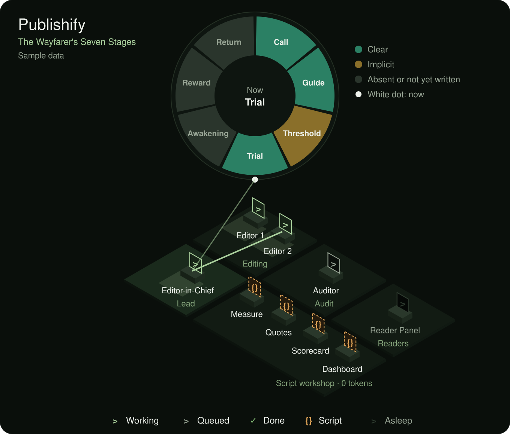

<p align="center">
  <a href="https://publishify.app/refine/">
    <picture>
      <source media="(prefers-color-scheme: dark)" srcset="https://publishify.app/img/logo-beyaz.svg">
      
    </picture>
  </a>
</p>

<h1 align="center">The Publishify editorial board</h1>

<p align="center"><strong>A publishing house behind your book, inside your own AI.</strong></p>

<p align="center">
  <a href="#install"><strong>Install</strong></a> ·
  <a href="https://publishify.app/sample-report/">Sample report</a> ·
  <a href="https://publishify.app/pricing/">Pricing</a> ·
  <a href="README.tr.md">Türkçe</a> ·
  <a href="https://github.com/publishify/publishify">The Publishify editor</a>
</p>

<p align="center">
  
</p>
<p align="center"><sub>An illustration with sample data, not a real review.</sub></p>

This is the editorial board of [Publishify](https://github.com/publishify/publishify), the writing editor at [write.publishify.app](https://write.publishify.app/). It is a plugin for the AI application you already use. An **Editor**, a **Continuity Checker**, a **panel of three readers** and an **Editor-in-Chief** read your book, give notes that each rest on a quotation from your text, and put everything in one dashboard you can open, print or share.

Write and export your book in Publishify, or bring a file from any other tool. **Your book never goes to Publishify's servers:** your own AI reads it, and the plugin's scripts run in your AI's own workspace. The final decision always stays with you.

## The board

| Role | What it reads for | What you get |
| --- | --- | --- |
| **Editor** | Structure, pace, point of view, scenes that work and scenes that drift | Notes with the passage and location they rest on, strengths to keep, and the book mapped onto the Wayfarer's Seven Stages |
| **Continuity Checker** | Names, ages, dates, deaths, counts and facts across distant chapters | Each contradiction with both quotations side by side |
| **Reader panel** | Three simulated readers of your genre, reading apart from each other | Where each one grew curious, drifted away or will remember |
| **Editor-in-Chief** | Everything the board wrote | One ordered list: the three things to look at first, then the rest |

Python scripts do the measurable work: reading DOCX, EPUB, Markdown and text, splitting chapters and paragraphs, counting, listing facts, and **checking every quotation against your text**. A note whose quotation is not in the book is dropped before it reaches the dashboard. The board advises; it never rewrites your text and never gives scores or verdicts.

## The dashboard

One HTML file that opens offline in any browser:

- **The Wayfarer's Seven Stages clock**, by Ali Osman Akçaoğlu: where each stage falls in your book, each with its quotation. A map, not a checklist.
- **Key decisions** and the board's notes, every one with its quote and location.
- **Chapter bars** with word counts and which chapters are worth a look.
- **A character map:** who appears in how many paragraphs, and with whom.
- **Word and sentence patterns:** repeated phrases and long sentences, counted, not judged.

**See it on a real book:** the board read the original French text of *The Little Prince* (27 chapters, 14,078 words) on 16 November 2026 and wrote 46 notes, among them a genuine contradiction in the book (forty-three sunsets in one chapter, forty-four in another), found and quoted by the Continuity Checker. [Open the sample report →](https://publishify.app/sample-report/)

## Install

The first release is for **Claude**: Claude Code and the Claude desktop app with plugins.

```text
/plugin marketplace add publishify/plugin
/plugin install publishify@publishify
```

Then add your manuscript and say *"Review this with Publishify"*, or run:

```text
/publishify:review my-book.docx
/publishify:status
```

You sign in to Publishify once (Google or an e-mail code). The form asks what you wrote and what you would like, in your own language, with an example answer for every question.

**Codex:** `codex plugin marketplace add publishify/plugin` · **ChatGPT:** a custom connector to `https://mcp.publishify.app` · **Gemini CLI:** `gemini extensions install https://github.com/publishify/plugin`

[Installation for every app →](docs/installation.md)

## Plans

- **Free:** three previews a month. The Editor reads and gives the most useful notes.
- **Single review, packs and Pro:** for the whole board. Pro is $19 a month or $190 a year. Publishers, agencies and universities can apply for a custom plan.
- **Your AI usage** runs on your own AI account, within your provider's limits; Publishify charges only for the board.

Payments are handled by Paddle, our merchant of record. [Pricing →](https://publishify.app/pricing/) · [Refunds →](https://publishify.app/refunds/)

## What runs where

| In your AI application | On the Publishify server (`mcp.publishify.app`) |
| --- | --- |
| Your manuscript and its full text | Sign-in and your licence |
| The reading, with your own AI account | The desk catalogue and the role cards |
| The scripts: reading, counting, quotation checks | Each board's order of work |
| The dashboard | Usage counts, never the text |

Notes you keep can contain short quotations; your AI provider processes your attachment under its own terms. [Architecture →](docs/architecture.md) · [Privacy →](docs/privacy.md)

## Status

18 November 2026: plugin version 0.1.7. The **Fiction desk** (novels and stories) is ready in Claude; the first full board on a whole book ran on 16 November 2026. Desks for non-fiction, children's books, articles and theses, and support for ChatGPT, Codex, Cursor and Gemini, follow. [Current status →](docs/status.md) · [Roadmap →](docs/roadmap.md)

## Repository map

```text
.claude-plugin/                 Plugin and marketplace manifests
commands/                       /publishify:review and /publishify:status
skills/publishify/              The core board flow and its scripts
  scripts/board.py              Prepare the book, check quotes, merge the board's notes
  scripts/dashboard.py          Build the offline dashboard
  scripts/people.py             The character map
  scripts/text.py, facts.py, quotes.py
skills/publishify-fiction/      The Fiction desk
docs/                           Architecture, privacy, installation, status, roadmap
```

## Contribute

Start with [contributing](docs/contributing.md). Never put a manuscript, personal data or credentials in an issue.

The code is under the [MIT licence](LICENSE). The Publishify name, logo and artwork are not covered by it. The role cards and desk catalogue live on the private server, not in this repository.

**Contact:** [info@publishify.app](mailto:info@publishify.app)
