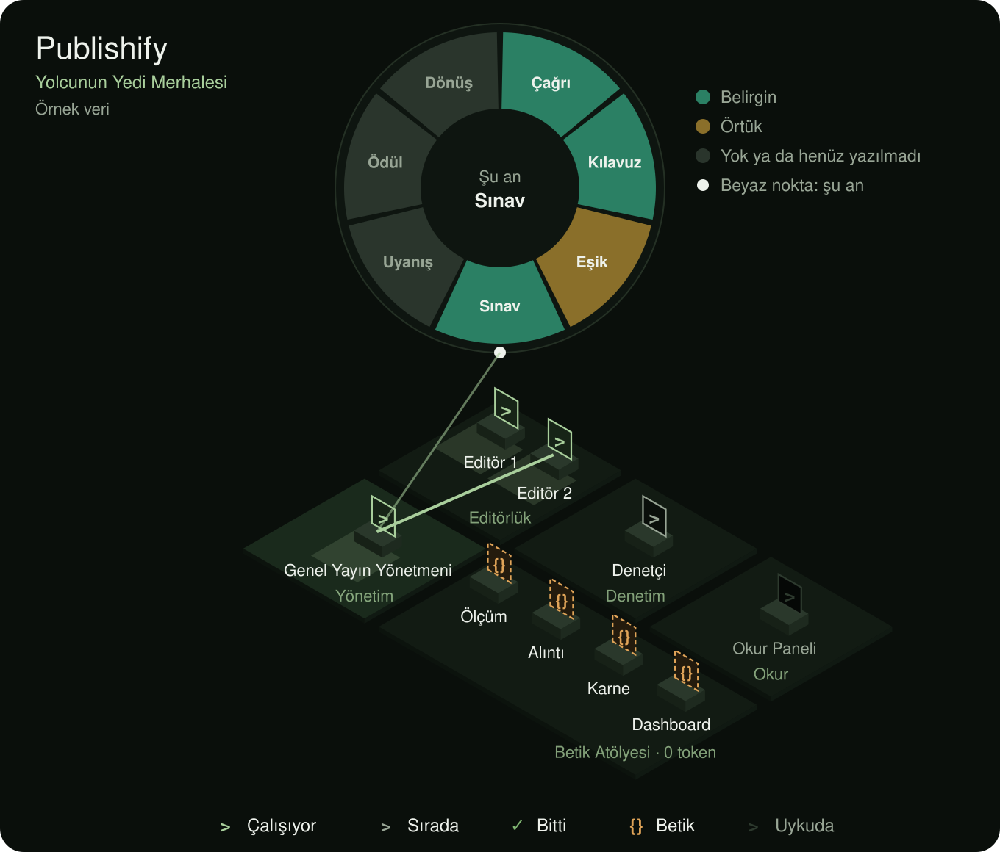

<p align="center">
  <a href="https://publishify.app/tr/gelistir/">
    <picture>
      <source media="(prefers-color-scheme: dark)" srcset="https://publishify.app/img/logo-beyaz.svg">
      
    </picture>
  </a>
</p>

<h1 align="center">Publishify yayın kurulu</h1>

<p align="center"><strong>Kitabının arkasında bir yayınevi, kendi yapay zekânın içinde.</strong></p>

<p align="center">
  <a href="#kurulum"><strong>Kur</strong></a> ·
  <a href="https://publishify.app/tr/ornek-rapor/">Örnek rapor</a> ·
  <a href="https://publishify.app/tr/fiyatlar/">Fiyatlar</a> ·
  <a href="README.md">English</a> ·
  <a href="https://github.com/publishify/publishify">Publishify yazı editörü</a>
</p>

<p align="center">
  
</p>
<p align="center"><sub>Örnek verilerle hazırlanmış bir görsel; gerçek bir inceleme değildir.</sub></p>

Bu, [write.publishify.app](https://write.publishify.app/?lang=tr) adresindeki yazı editörü [Publishify](https://github.com/publishify/publishify)'ın yayın kuruludur. Zaten kullandığın yapay zekâ uygulamasına eklenen bir eklentidir. **Editör**, **Süreklilik denetçisi**, **üç kişilik Okur Paneli** ve **Yayın yönetmeni** kitabını okur; her notu kitabından bir alıntıya dayanır. Hepsi tek bir panoda toplanır: açarsın, yazdırırsın, editörünle paylaşırsın.

Kitabını Publishify'da yazıp dışa aktarabilir ya da başka bir araçtan dosya getirebilirsin. **Kitabın Publishify sunucularına gitmez:** onu kendi yapay zekân okur, eklentinin betikleri yapay zekânın kendi çalışma alanında çalışır. Son karar her zaman sende.

## Kurul

| Rol | Neye bakar | Sana ne verir |
| --- | --- | --- |
| **Editör** | Yapı, tempo, bakış açısı, işleyen ve dağılan sahneler | Dayandığı pasaj ve yeriyle notlar, korunacak güçlü yanlar ve kitabın Yolcunun Yedi Merhalesi haritası |
| **Süreklilik denetçisi** | Uzak bölümler arasında adlar, yaşlar, tarihler, ölümler, sayılar | Her çelişki, iki alıntısı yan yana |
| **Okur Paneli** | Türünün üç canlandırılmış okuru, birbirinden habersiz | Her birinin nerede merak ettiği, nerede uzaklaştığı, neyi hatırlayacağı |
| **Yayın yönetmeni** | Kurulun yazdığı her şey | Tek sıralı liste: önce bakılacak üç şey, sonra geri kalanı |

Ölçülebilir işi Python betikleri yapar: DOCX, EPUB, Markdown ve metin okumak, bölüm ve paragraflara ayırmak, saymak, olguları listelemek ve **her alıntıyı kitabında aramak**. Alıntısı kitapta bulunmayan not panoya giremez. Kurul tavsiye verir; metnini yeniden yazmaz, puan ya da hüküm vermez.

## Pano

İnternetsiz açılan tek bir HTML dosyası:

- **Yolcunun Yedi Merhalesi (Kahramanın Yolculuğu Şablonu) saati**, Ali Osman Akçaoğlu'nun yaklaşımı: her merhalenin kitabında nereye düştüğü, alıntısıyla. Bir harita, kontrol listesi değil.
- **Ana kararlar** ve kurulun notları; her biri alıntısı ve yeriyle.
- **Bölüm çubukları:** sözcük sayıları ve bakmaya değer bölümler.
- **Karakter haritası:** kim kaç paragrafta, kiminle geçiyor.
- **Sözcük ve cümle kalıpları:** tekrar eden öbekler ve uzun cümleler; sayılır, yargılanmaz.

**Gerçek bir kitapta gör:** Kurul 16 Kasım 2026'da *Küçük Prens*'in özgün Fransızca metnini (27 bölüm, 14.078 sözcük) okudu ve 46 not yazdı. Bunlardan biri kitaptaki gerçek bir çelişki: bir bölümde kırk üç, başka bir bölümde kırk dört gün batımı. Süreklilik denetçisi iki alıntısıyla buldu. [Örnek raporu aç →](https://publishify.app/tr/ornek-rapor/)

## Kurulum

İlk sürüm **Claude** için: Claude Code ve eklenti destekli Claude masaüstü uygulaması.

```text
/plugin marketplace add publishify/plugin
/plugin install publishify@publishify
```

Sonra kitabını ekle ve *"Bunu Publishify ile incele"* de ya da:

```text
/publishify:review kitabim.docx
/publishify:status
```

Publishify'a bir kez giriş yaparsın (Google ya da e-posta kodu). Form, ne yazdığını ve ne istediğini kendi dilinde, her soru için örnek bir cevapla sorar.

**Codex:** `codex plugin marketplace add publishify/plugin` · **ChatGPT:** `https://mcp.publishify.app` adresine özel bağlayıcı · **Gemini CLI:** `gemini extensions install https://github.com/publishify/plugin`

[Her uygulama için kurulum →](docs/installation.md)

## Planlar

- **Ücretsiz:** ayda üç ön değerlendirme. Editör okur, en faydalı notları verir.
- **Tek inceleme, paketler ve Pro:** bütün kurul için. Pro ayda 19 $ ya da yılda 190 $. Yayınevi, ajans ve üniversiteler özel paket için başvurabilir.
- **Yapay zekâ kullanımı** kendi hesabında, sağlayıcının sınırları içinde çalışır; Publishify yalnızca kurul için ücret alır.

Ödemeleri satıcı kayıtlı aracımız Paddle yürütür. [Fiyatlar →](https://publishify.app/tr/fiyatlar/) · [İade →](https://publishify.app/tr/iade/)

## Durum

18 Kasım 2026: eklenti sürümü 0.1.7. **Kurgu masası** (roman ve öykü) Claude'da hazır; bütün bir kitap üzerindeki ilk tam kurul 16 Kasım 2026'da çalıştı. Kurgu dışı, çocuk kitabı, makale ve tez masaları ile ChatGPT, Codex, Cursor ve Gemini desteği sırada. [Güncel durum →](docs/status.md) · [Yol haritası →](docs/roadmap.md)

## Belgeler

[Mimari ve veri akışı](docs/architecture.md) · [Kurgu masası](docs/fiction-desk.md) · [Kurulum](docs/installation.md) · [Gizlilik](docs/privacy.md) · [Katkı rehberi](docs/contributing.md)

Kod [MIT lisansıyla](LICENSE) açıktır. Publishify adı, logosu ve görselleri bu lisansa dahil değildir. Rol kartları ve masa kataloğu bu depoda değil, gizli sunucuda durur.

**İletişim:** [info@publishify.app](mailto:info@publishify.app)
