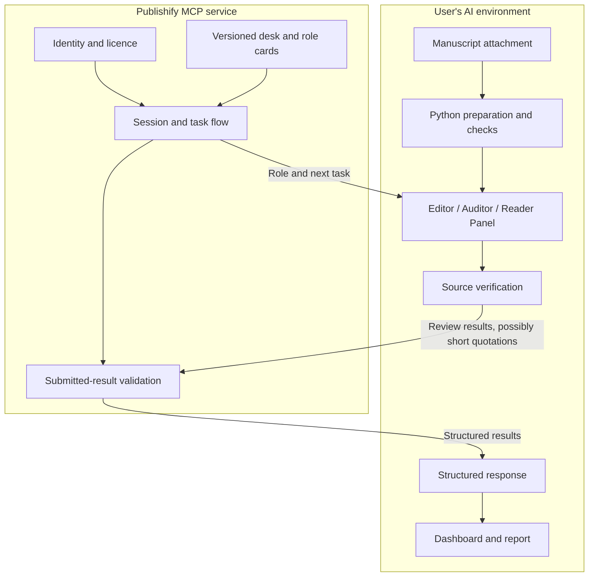

# Architecture and data boundaries

Status: intended F1 architecture, 15 November 2026. This is a product specification, not a claim that the implementation is complete.

## Two execution environments

The original file and extracted full text do not cross the Publishify service boundary. The model receives text in the user's AI environment; the AI provider's processing rules still apply. Not every host has a local computer runtime — a host-managed cloud sandbox is also an AI environment.

## Server responsibilities

Authentication, identity linking, email-linked licences, allowances, sessions, desk catalogue, versioned role cards, task order and submitted-result validation. The service does not run the reading model. A persistent manuscript, note or report archive is not part of the target service.

Role cards become visible to the AI client when supplied as assignments. Access-controlled server functionality is distinct from copying a public prompt or skill.

## Host responsibilities

File parsing and splitting, measuring, fact extraction, name-drift and death-appearance candidates, spelling checks, quotation matching, contextual reading, aggregation and report rendering. Script output must be checked rather than assumed to exist because a tool response requested it.

PDF is a report output. DOCX, EPUB, Markdown and TXT are the planned first-release inputs.

## Rules and hooks

A server rule is mandatory for requests reaching that service. It cannot control unrelated conversation content or scripts that never call the service. Do not equate these rules with host-native lifecycle hooks.

Source verification needs the source. Because the server does not receive the full manuscript, the source quotation check runs in the AI environment. The server can validate submitted fields and workflow constraints; it cannot independently prove every submitted quotation against an absent full manuscript.

## Host-dependent interface

Use a supported in-chat window or form where available. Otherwise gather choices in conversation. A terminal can open a generated report file without supporting MCP Apps. Named perspectives are not automatically separate-context subagents; real delegation must be verified per host.
